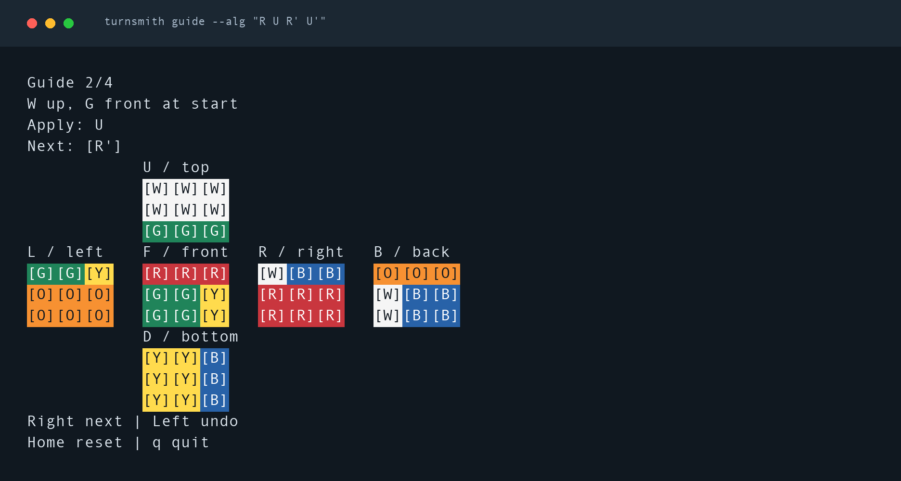
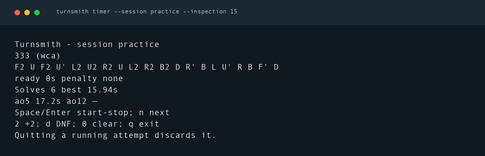
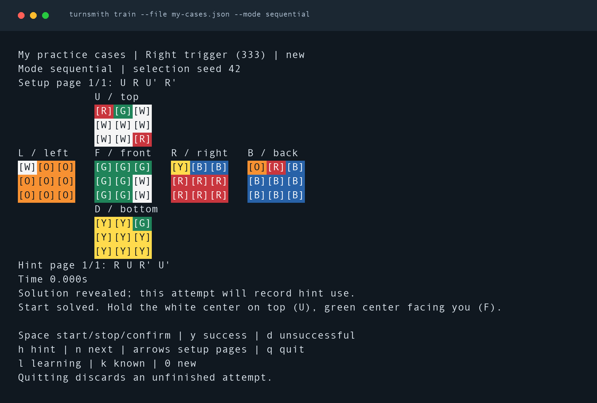

<div align="center">

# turnsmith

### Scramble. Follow each turn. Time your solve.

Offline Rubik's Cube practice in your terminal, for 2×2, 3×3 and 4×4.

[](https://github.com/frivas/turnsmith/actions/workflows/ci.yml?query=branch%3Amain)
[](https://github.com/frivas/turnsmith/releases/latest)

[Get started](#quick-start) · [Install](#installation) · [Cube guide](#interactive-guide-and-supplied-sequences) · [Timer](#timer-and-sessions) · [Algorithm practice](#algorithm-practice) · [Command reference](#flags)



*The interactive guide, two moves into `R U R' U'`. Every sticker has a letter as well as a color.*

</div>

Run `turnsmith` for one competition-style 3×3 scramble. Open the guide to follow
moves on a colored cube, time solves in local sessions, or practise your own
algorithm collections. Everything runs offline after installation.

| Scramble and inspect | Follow each turn | Build a practice routine |
| --- | --- | --- |
| Generate 2×2, 3×3 and 4×4 scrambles. Replay saved moves or inspect your own algorithms. | Step forward and back through a cube net. See the inverse move when you undo a turn. | Time solves, track ao5 and ao12, and repeat cases from your own collections. |

> Turnsmith is practice software. Its default `wca` method samples random states
> with WCA minimum-distance filters, but it is not an official competition
> scramble program. Competitions must use the current
> [official TNoodle release](https://www.worldcubeassociation.org/regulations/scrambles/).

## Quick start

[Install Turnsmith](#installation), then open a terminal. Hold a solved cube with
**white on top and green facing you**.

### 1. Get a scramble

```sh
turnsmith
```

The default is a competition-style 3×3 scramble, printed on one line. Select
another cube with `--puzzle 222` or `--puzzle 444`. Default 4×4 generation needs
the `turnsmith-wca` companion included in the release package.

### 2. Follow a short algorithm

```sh
turnsmith guide --alg "R U R' U'"
```

Press **Space** or **→** for the next move, **←** to undo, and **q** to quit.
To follow a generated scramble instead, run `turnsmith guide --seed 42`.

### 3. Time a solve

```sh
turnsmith timer --session practice --inspection 15
```

Press **Space** to begin inspection, again to start the timer, and again to stop
and save your solve. Press **n** for the next scramble.

Useful commands to try next:

| I want to… | Command |
| --- | --- |
| See the final cube state | `turnsmith --seed 42 --diagram` |
| Print a diagram after every move | `turnsmith --method random-move --seed 42 --length 3 --steps` |
| Save five reproducible scrambles | `turnsmith --count 5 --seed 42 --json > scrambles.json` |
| Follow a saved scramble | `turnsmith guide --file scrambles.json --index 2` |
| See my session results | `turnsmith sessions show practice` |
| Find a command's options | `turnsmith help` |

## Installation

Download a compiled package from [GitHub Releases](https://github.com/frivas/turnsmith/releases/latest).
No Go installation is required. Each package contains `turnsmith` and
`turnsmith-wca`. Install both for default 4×4 generation. Once installed, they run
offline.

The v0.3.0 downloads are:

| Platform | Architecture | Download |
| --- | --- | --- |
| macOS | Apple Silicon, ARM64 | [darwin_arm64.tar.gz](https://github.com/frivas/turnsmith/releases/download/v0.3.0/turnsmith_0.3.0_darwin_arm64.tar.gz) |
| macOS | Intel, AMD64 | [darwin_amd64.tar.gz](https://github.com/frivas/turnsmith/releases/download/v0.3.0/turnsmith_0.3.0_darwin_amd64.tar.gz) |
| Linux | ARM64 | [linux_arm64.tar.gz](https://github.com/frivas/turnsmith/releases/download/v0.3.0/turnsmith_0.3.0_linux_arm64.tar.gz) |
| Linux | AMD64 | [linux_amd64.tar.gz](https://github.com/frivas/turnsmith/releases/download/v0.3.0/turnsmith_0.3.0_linux_amd64.tar.gz) |
| Windows | ARM64 | [windows_arm64.zip](https://github.com/frivas/turnsmith/releases/download/v0.3.0/turnsmith_0.3.0_windows_arm64.zip) |
| Windows | AMD64 | [windows_amd64.zip](https://github.com/frivas/turnsmith/releases/download/v0.3.0/turnsmith_0.3.0_windows_amd64.zip) |

<details>
<summary><strong>macOS and Linux installation</strong></summary>

### macOS and Linux

This downloads v0.3.0 for your machine, checks its SHA-256, and installs both executables in
`~/.local/bin`. Change `version` to install another published release.

```sh
(
  set -eu
  version=0.3.0
  case "$(uname -s)" in
    Darwin) os=darwin ;;
    Linux) os=linux ;;
    *) echo "Use the Windows instructions below." >&2; exit 1 ;;
  esac
  case "$(uname -m)" in
    arm64|aarch64) arch=arm64 ;;
    x86_64|amd64) arch=amd64 ;;
    *) echo "Unsupported CPU architecture." >&2; exit 1 ;;
  esac
  download_dir="$(mktemp -d)"
  trap 'rm -rf "$download_dir"' EXIT
  cd "$download_dir"
  archive="turnsmith_${version}_${os}_${arch}.tar.gz"
  base="https://github.com/frivas/turnsmith/releases/download/v${version}"
  curl -fLO "$base/$archive"
  curl -fLO "$base/SHA256SUMS"
  if [ "$os" = darwin ]; then
    shasum -a 256 --check --ignore-missing SHA256SUMS
  else
    sha256sum --check --ignore-missing SHA256SUMS
  fi
  tar -xzf "$archive" turnsmith turnsmith-wca
  mkdir -p "$HOME/.local/bin"
  install -m 755 turnsmith "$HOME/.local/bin/turnsmith"
  install -m 755 turnsmith-wca "$HOME/.local/bin/turnsmith-wca"
)
```

Make sure `~/.local/bin` is on your PATH. In zsh or bash, add
`export PATH="$HOME/.local/bin:$PATH"` to your shell's startup file if needed,
then open a new terminal. Verify with `turnsmith --version` and
`turnsmith-wca --version`. The archive also includes `BACKEND-LICENSE.txt` and
third-party notices. Retain them when redistributing the package.

</details>

<details>
<summary><strong>Windows installation</strong></summary>

### Windows

Download the matching ZIP and [SHA256SUMS](https://github.com/frivas/turnsmith/releases/download/v0.3.0/SHA256SUMS).
In PowerShell, run `Get-FileHash .\turnsmith_0.3.0_windows_amd64.zip -Algorithm SHA256`,
using your downloaded filename, and compare it with the matching line in
`SHA256SUMS`. Extract the ZIP and put both `turnsmith.exe` and
`turnsmith-wca.exe` in the same folder on your PATH. Retain the accompanying
license and notice files. Run `turnsmith --version` and `turnsmith-wca --version`
in a new terminal.

</details>

macOS and Windows binaries are currently unsigned. A Homebrew tap is not
available. See [releasing](docs/releasing.md) for the current signing status.

<details>
<summary><strong>Install with Go or build from source</strong></summary>

### Install with Go

If you have Go 1.27 or later:

```sh
go install github.com/frivas/turnsmith/cmd/turnsmith@v0.3.0
go install github.com/frivas/turnsmith/cmd/turnsmith-wca@v0.3.0
```

Go installs to `GOBIN`, or `$(go env GOPATH)/bin` when `GOBIN` is unset. Add that
directory to your PATH. Use `@latest` instead of `@v0.3.0` for the latest stable
Go module version. Install both commands at the same version.

### Build from source

From a checkout of this repository with Go 1.27 or later:

```sh
go build -trimpath -o bin/turnsmith ./cmd/turnsmith
go build -trimpath -o bin/turnsmith-wca ./cmd/turnsmith-wca
./bin/turnsmith
```

On Windows, use `bin/turnsmith.exe` and `bin/turnsmith-wca.exe` as the output
names, then run `.\bin\turnsmith.exe`. Keep both executables together.

Each release also attaches
[`turnsmith-wca_0.3.0_source.tar.gz`](https://github.com/frivas/turnsmith/releases/download/v0.3.0/turnsmith-wca_0.3.0_source.tar.gz),
the backend's corresponding source with vendored Go dependencies for offline
builds. Its included instructions describe the build and license.

</details>

## Holding the cube and following a scramble

Start with a solved cube. Hold the **white face on top** and the **green face
facing you**, then keep that orientation throughout the scramble. The face
letters name positions, not whichever colored tile happens to be there.


`U` is up, `D` down, `L` left, `R` right, `F` front, and `B` back. Turn only the
named outer layer; a wide token such as `Rw` turns two layers. A plain letter is a 90-degree clockwise turn **looking
directly at that face**; an apostrophe reverses it, and `2` means 180 degrees.
This viewpoint matters for the back, left, and bottom faces. For example, `R'`
means turn the right face 90 degrees counterclockwise when looking at its center.
These orientation and notation conventions follow the
[WCA reference](https://www.worldcubeassociation.org/regulations/#4d1); using them
does not make this generator competition approved.

For a labeled, colored diagram after every move:

```sh
turnsmith --method random-move --seed 42 --length 3 --steps
```

The guide prints the full scramble, holding instructions, the solved starting
state, and the resulting six-face tile diagram after each move. The example is
`L2 D' U`, so it shows four states, starting at `Step 0/3: solved`. Each batch
scramble starts solved independently. A different physical starting state will
not match these diagrams. Other color schemes can follow face positions, but
the displayed colors assume the reference scheme above.

Colors are automatic on a terminal. Tiles also carry `W`, `Y`, `O`, `R`, `G`,
or `B` so they remain readable without color. To keep colors while scrolling a
full scramble, or to request plain diagrams:

```sh
turnsmith --seed 42 --steps --color always | less -R
turnsmith --seed 42 --steps --color never
```

`--color auto` respects `NO_COLOR` and `TERM=dumb` and omits ANSI codes when
output is redirected. Step diagrams support at most 1000 moves across a batch
and cannot be combined with `--json`. Default text and JSON generation do not
include diagrams. The state simulator is used only for displaying these steps;
it does not change the generator or its reproducibility contract.

## Interactive guide and supplied sequences

Keep one colored cube on screen as you work through generated scrambles or your
own algorithms.

```sh
turnsmith guide --seed 42
turnsmith guide --alg "R U R' U'"
turnsmith inspect --alg "[R,U]" --steps
turnsmith inverse --alg "(R U R' U')3"
turnsmith --seed 42 --diagram
turnsmith --seed 42 --count 5 --json > scrambles.json
turnsmith guide --file scrambles.json --index 2
cat scrambles.json | turnsmith inspect --stdin --index 2 --json
```

| Key | Action |
| --- | --- |
| → / Space / Enter | Apply the next move |
| ← | Go back and show the inverse move to undo |
| Home | Reset the displayed progress |
| End | Display the final state |
| `q` | Quit |

A reset or jump changes the display only. Follow the displayed physical-cube
instructions before continuing. `inspect` accepts one quoted argument, `--alg`,
`--file`, or stdin, including saved generation, inspection, and daily-set JSON.
All imported moves replay from solved; arbitrary sticker layouts are unsupported.
Interactive modes require terminal stdin and stdout; streamed inspection works
in pipes.
See [terminal controls and completions](docs/terminal.md).

## Timer and sessions



*An example session with six sample solves. Times and averages stay on screen
while you practise.*

```sh
turnsmith timer --session practice --inspection 15
turnsmith sessions show practice
turnsmith sessions add practice --time 12.345 --scramble "R U R' U'" --penalty +2 --notes "missed AUF"
turnsmith sessions export --format csv --file times.csv
turnsmith sessions import --format csv --file times.csv
```

| Key | Action |
| --- | --- |
| Space / Enter | Begin inspection, start timing, or stop and save |
| `n` | Load the next scramble |
| `2` / `d` / `0` | Set +2, DNF, or no penalty on the saved solve |
| `q` | Quit; a running attempt is discarded |

Timing uses key presses and a monotonic clock. It does not require key release
support. Omit `--inspection 15` to start timing on the first press. Sessions
report best/worst singles, ao5 and ao12, including +2 and DNF handling.

Notes, editing, JSON/CSV backup and explicit recovery are available through
`sessions --help`. Only explicit session/training commands write local practice
data. Import/export supports Turnsmith's versioned formats; third-party timer
exports require conversion. See [session storage and recovery](docs/sessions.md).

## Algorithm practice



*The example collection below, with its algorithm revealed by pressing `h`.*

Save this as `my-cases.json`:

```json
{
  "schema_version": 1,
  "name": "My practice cases",
  "cases": [
    {"id": "right-trigger", "name": "Right trigger", "puzzle": "333", "algorithm": "R U R' U'"}
  ]
}
```

```sh
turnsmith train --file my-cases.json --mode sequential
```

Follow the inverse setup from solved, then press **Space** to start and stop.
Press **y** to record success or **d** for an unsuccessful attempt. **h** reveals
the algorithm; **l**, **k**, and **0** mark the case learning, known, or new.

Training uses your own collections. Each case has an inverse setup, hint reveal,
and timed repetitions. Select cases with `balanced`, `learning`, `slowest`, or
`sequential`. See [training format and controls](docs/training.md).

### Make a daily set

```sh
turnsmith daily --date 2026-10-31 --name weekend --count 10 --output weekend.json
turnsmith guide --file weekend.json --index 1
```

Save a reproducible set to work through or share. The file keeps the moves so
you can replay them after generator changes. See [daily practice sets](docs/daily-practice.md).

## Flags

These flags apply to ordinary scramble generation. Run `turnsmith help COMMAND`
for guide, timer, training, and session options.

| Flag | Short | Default | Allowed values |
| --- | --- | --- | --- |
| `--puzzle` | `-p` | `333` | `222`, `333`, `444` and their NxN/NxNxN aliases |
| `--method` | | `wca` | `wca` for 222/333/444; legacy `random-state` for 222/333 and `random-move` for 333/444 |
| `--length` | `-l` | Method-selected | 1–1000 for explicit `random-move`, default 25 for 333 or 40 for 444; unavailable for `wca` and `random-state` |
| `--count` | `-n` | `1` | Decimal integer 1–10000 |
| `--seed` | | Direct OS entropy for `wca` | Unsigned decimal 64-bit integer; selects reproducible seeded practice |
| `--json` | | `false` | Boolean |
| `--steps` | | `false` | Show initial and per-move cube diagrams |
| `--diagram` | | `false` | Show only the final cube state |
| `--color` | | `auto` | `auto`, `always`, `never`; requires diagrams |
| `--color-depth` | | `auto` | `auto`, `16`, `256`, `truecolor` |
| `--help` | `-h` | | Show help |
| `--version` | | | Name and version only |

Use `--flag value`, `--flag=value`, or short equivalents such as `-l 30`.
Boolean flags accept `=true` or `=false`. Repeated flags, short-flag bundles,
positionals, and unknown flags are rejected. `puzzles` accepts only `--json`
and help; `version` accepts help; `help COMMAND` shows command-specific options.
`--version` cannot be combined with other flags. A request may contain at most
1,000,000 moves. Errors go to stderr with `error:` and no scramble output for
invalid requests. Exit codes: 0 success, 1 runtime or output failure, 2 invalid
input, 130 interruption. An output failure may leave already-written bytes.

Aliases such as `2x2`, `3x3x3`, and `4x4` select their canonical puzzle.
Unsupported identifiers fail without substituting another puzzle. Successful
text output is one sequence per line, single ASCII spaces, no numbering,
wrapping, ANSI codes, or metadata, and a final newline. Batches are generated
completely before output starts.

## Competition-style defaults and legacy methods

```sh
turnsmith --puzzle 222
turnsmith --puzzle 333 --diagram
turnsmith --puzzle 444 --steps
turnsmith --puzzle 444 --seed 42 --json
turnsmith --puzzle 333 --method random-move --length 25 --seed 42
turnsmith --puzzle 333 --method random-state --seed 42
```

`wca` samples reachable states and rejects states closer than four moves for
222, or two moves for 333 and 444. It chooses the output move count and rejects
`--length`. Unseeded requests draw directly from the operating system's
cryptographic random source. Supplying `--seed` keeps the distance filter and
selects reproducible seeded practice. These guarantees do not confer official
competition approval. [WCA Regulation 4b](https://www.worldcubeassociation.org/regulations/#4b)
requires the current official scramble program at competitions.

222 and 333 generation run inside the main CLI. Default 444 generation launches
`turnsmith-wca`, the separately licensed native Go port of Shuang Chen's TNoodle
threephase solver. Install it alongside `turnsmith`; the CLI also checks PATH.
`TURNSMITH_WCA_BACKEND` can select an explicit backend path. Tables initialize
lazily in memory on first use. Initialization and search are bounded and
cancellable. Missing companions or exhausted searches return errors and do not
substitute random moves. No Java, network service, or downloaded table is needed.

Legacy `333/random-move`, `444/random-move`, and `222/333/random-state` algorithm
version 1 remain available explicitly with their existing seeded sequences.
Random-move methods do not uniformly sample states. Legacy random-state methods
retain their original sampling and do not apply the new `wca` distance filter.
Use `--method random-move` when choosing a scramble length.

The [native 4×4 port research](docs/research/wca-444-backend.md) and
[earlier random-state engine decision](docs/research/random-state-engine.md)
record the implementation sources and validation limits.

## Notation and algorithm

Outer faces are `U D L R F B`. A bare letter means a clockwise quarter turn
when looking directly at that face. `2` means a half turn; a straight ASCII
apostrophe means a counterclockwise quarter turn. `R`, `R2`, and `R'` each count
as one token. 333 random-move uses outer turns only. 444 random-move also generates two-layer
wide turns such as `Rw`. Inspection supports `M E S`, `x y z`, wide turns and
lowercase wide aliases, groups `(R U)3`, commutators `[R,U]` and conjugates `[R:U]`.
Invalid moves for a puzzle fail before diagram output. Slices require odd-sized
cubes; on 222 use outer turns and whole-cube rotations.

In the random-move methods, adjacent moves cannot use the same face. A face cannot repeat across its
opposite face, so `R L R'`, `U D2 U2`, and `F B F` are excluded. Opposite-face
pairs such as `R L` remain legal. The generator selects directly from valid
faces in a fixed order; it has no visited-state history.
Uniform next-move selection does not imply uniform state sampling.

See [algorithms](docs/algorithms.md) for the exact ordering and selection rules.

## Seeds and JSON

Seeds include zero and `18446744073709551615`. Negative, fractional,
hexadecimal, empty, overflowing, signed, and whitespace-padded values fail.

For the default `wca` method, omitting `--seed` draws state randomness directly
from the OS cryptographic source. JSON reports `"randomness": "cryptographic"`
and an empty `"seed"`. Save the emitted moves for replay. Entropy failure is
fatal. Explicit seeds use `"randomness": "seeded-practice"`; daily sets always
use this reproducible mode. Public or predictable seeds are for practice, not
secret competition scramble generation.

For seeded requests, the same root seed, canonical puzzle, method, algorithm
version, length, and zero-based batch index reproduce the same sequence.
Increasing batch size preserves earlier results. Aliases and output format do
not change the stream. Legacy methods still obtain an automatic root seed when
none is supplied. Seed alone is insufficient after an algorithm-version change.
See the [reproducibility contract and vectors](docs/reproducibility.md).

`--json` emits one document with schema version 1. Nonempty seeds are decimal
strings so JavaScript does not lose precision. Output records application and
algorithm versions, puzzle, method, parameters, and one-based scramble indices.
Each scramble contains `moves`, `sequence`, and `move_count`. Saved moves can be
replayed independently of generator changes. The following is an explicit
legacy random-move request with `--length 3 --seed 42`:

```json
{
  "schema_version": 1,
  "app_version": "0.3.0",
  "puzzle": "333",
  "method": "random-move",
  "algorithm_version": "1",
  "seed": "42",
  "parameters": {"length": 3, "count": 1},
  "scrambles": [
    {"index": 1, "moves": ["L2", "D'", "U"], "sequence": "L2 D' U", "move_count": 3}
  ]
}
```

## Releases

Read the [changelog](CHANGELOG.md) or browse [release downloads](https://github.com/frivas/turnsmith/releases).

Push a SemVer tag such as `v0.3.0` to run native CI and automatically publish a
GitHub release with six compiled packages: macOS, Linux, and Windows on AMD64
and ARM64. Each package contains both executables. Each release includes version highlights,
a commit changelog, download links, SHA-256 checksums, and backend source. Prerelease tags such as `v0.3.0-rc.1` create GitHub prereleases.

The Release workflow also supports manual previews that build and upload the
same artifacts without tagging or publishing. See [releasing](docs/releasing.md)
for the commands, version rules, and platform signing status.

## Development and contributing

```sh
go test ./...
go vet ./...
go test -race ./...
go run ./scripts/check-format.go
go test ./internal/app -run '^$' -bench . -benchmem
```

Run `gofmt -w cmd internal scripts` before contributing. Changes should include
tests of observable behavior. Golden vector changes require an explanation and
an algorithm-version decision. CI runs integration tests on macOS, Linux, and
Windows, with race and short fuzz checks on Linux. Benchmarks have no hardware
thresholds. Building from source downloads the pinned Go modules. Release binaries
include their native code and need no runtime downloads.

To refresh the README images, see [screenshot capture instructions](docs/screenshots/README.md).

The [2026-11-05 security review](docs/security-review-2026-11-05.md) records the
Go vulnerability scan, static analysis, tests, and resolution of the findings.

See [architecture](docs/architecture.md), [adding a puzzle](docs/adding-a-puzzle.md),
and [releasing](docs/releasing.md). Cloud accounts, telemetry, Bluetooth hardware,
curated third-party training datasets and 3D graphics are outside this release.
Implementation packages are internal; there is no stable public Go API.

## License and attribution

Turnsmith's original CLI code is [MIT licensed](LICENSE), copyright Francisco
Rivas and contributors. The separate `turnsmith-wca` command and
`internal/tnoodle444` port are GPL-3.0-or-later, based on Shuang Chen's 2014
threephase implementation in TNoodle-lib, pinned at
`d01a947d9f028f38085cda9b0507a9cf3d3f38a8`. The CLI communicates with this companion
as a separate process and does not link the GPL solver package.

The backend's full license is [COPYING](internal/tnoodle444/COPYING), packaged as
`BACKEND-LICENSE.txt`. Each release includes its corresponding source archive and
offline build dependencies. [Third-party notices](THIRD_PARTY_NOTICES.md) preserve
backend attribution and the complete licenses for Go, PCG, gocube, and the
terminal dependencies. The MIT license applies to the original MIT code; it
does not replace the GPL terms on the backend.
