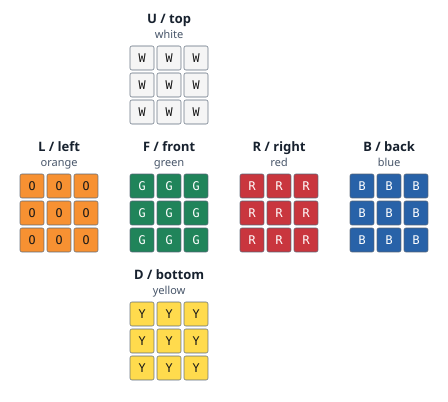

# turnsmith

[](https://github.com/frivas/turnsmith/actions/workflows/ci.yml?query=branch%3Amain)

Offline Rubik's Cube scrambles in a single executable. Run `turnsmith` to print
25 moves for casual 3×3×3 practice, with no headings or extra output.

Only **333 / random-move** is implemented. This method filters simple redundant
moves. It does **not** uniformly sample reachable cube states and is **not**
approved for official competition. The 25-move default is a product choice,
not a competition standard.

## Installation

Download a compiled executable from [GitHub Releases](https://github.com/frivas/turnsmith/releases/latest).
No Go installation is required. Once installed, `turnsmith` runs offline.

The v0.2.0 downloads are:

| Platform | Architecture | Download |
| --- | --- | --- |
| macOS | Apple Silicon, ARM64 | [darwin_arm64.tar.gz](https://github.com/frivas/turnsmith/releases/download/v0.2.0/turnsmith_0.2.0_darwin_arm64.tar.gz) |
| macOS | Intel, AMD64 | [darwin_amd64.tar.gz](https://github.com/frivas/turnsmith/releases/download/v0.2.0/turnsmith_0.2.0_darwin_amd64.tar.gz) |
| Linux | ARM64 | [linux_arm64.tar.gz](https://github.com/frivas/turnsmith/releases/download/v0.2.0/turnsmith_0.2.0_linux_arm64.tar.gz) |
| Linux | AMD64 | [linux_amd64.tar.gz](https://github.com/frivas/turnsmith/releases/download/v0.2.0/turnsmith_0.2.0_linux_amd64.tar.gz) |
| Windows | ARM64 | [windows_arm64.zip](https://github.com/frivas/turnsmith/releases/download/v0.2.0/turnsmith_0.2.0_windows_arm64.zip) |
| Windows | AMD64 | [windows_amd64.zip](https://github.com/frivas/turnsmith/releases/download/v0.2.0/turnsmith_0.2.0_windows_amd64.zip) |

### macOS and Linux

This downloads v0.2.0 for your machine, checks its SHA-256, and installs it in
`~/.local/bin`. Change `version` to install another published release.

```sh
(
  set -eu
  version=0.2.0
  case "$(uname -s)" in
    Darwin) os=darwin ;;
    Linux) os=linux ;;
    *) echo "Use the Windows instructions below." >&2; exit 1 ;;
  esac
  case "$(uname -m)" in
    arm64|aarch64) arch=arm64 ;;
    x86_64|amd64) arch=amd64 ;;
    *) echo "Unsupported CPU architecture." >&2; exit 1 ;;
  esac
  download_dir="$(mktemp -d)"
  trap 'rm -rf "$download_dir"' EXIT
  cd "$download_dir"
  archive="turnsmith_${version}_${os}_${arch}.tar.gz"
  base="https://github.com/frivas/turnsmith/releases/download/v${version}"
  curl -fLO "$base/$archive"
  curl -fLO "$base/SHA256SUMS"
  if [ "$os" = darwin ]; then
    shasum -a 256 --check --ignore-missing SHA256SUMS
  else
    sha256sum --check --ignore-missing SHA256SUMS
  fi
  tar -xzf "$archive" turnsmith
  mkdir -p "$HOME/.local/bin"
  install -m 755 turnsmith "$HOME/.local/bin/turnsmith"
)
```

Make sure `~/.local/bin` is on your PATH. In zsh or bash, add
`export PATH="$HOME/.local/bin:$PATH"` to your shell's startup file if needed,
then open a new terminal. Verify the installation with `turnsmith --version`.

### Windows

Download the matching ZIP and [SHA256SUMS](https://github.com/frivas/turnsmith/releases/download/v0.2.0/SHA256SUMS).
In PowerShell, run `Get-FileHash .\turnsmith_0.2.0_windows_amd64.zip -Algorithm SHA256`,
using your downloaded filename, and compare it with the matching line in
`SHA256SUMS`. Extract the ZIP, put `turnsmith.exe` in a folder on your PATH, and
run `turnsmith --version` in a new terminal.

macOS and Windows binaries are currently unsigned. A Homebrew tap is not
available. See [releasing](docs/releasing.md) for the current signing status.

### Install with Go

If you have Go 1.27 or later:

```sh
go install github.com/frivas/turnsmith/cmd/turnsmith@v0.2.0
```

Go installs to `GOBIN`, or `$(go env GOPATH)/bin` when `GOBIN` is unset. Add that
directory to your PATH. Use `@latest` instead of `@v0.2.0` for the latest stable
Go module version.

### Build from source

From a checkout of this repository with Go 1.27 or later:

```sh
go build -trimpath -o bin/turnsmith ./cmd/turnsmith
./bin/turnsmith
```

On Windows, build with `-o bin/turnsmith.exe` and run `.\bin\turnsmith.exe`.

## Releases

Read the [changelog](CHANGELOG.md) or browse [release downloads](https://github.com/frivas/turnsmith/releases).

Push a SemVer tag such as `v0.2.0` to run native CI and automatically publish a
GitHub release with six compiled packages: macOS, Linux, and Windows on AMD64
and ARM64. Each release includes its Git changelog, download links, and SHA-256
checksums. Prerelease tags such as `v0.2.0-rc.1` create GitHub prereleases.

The Release workflow also supports manual previews that build and upload the
same artifacts without tagging or publishing. See [releasing](docs/releasing.md)
for the commands, version rules, and platform signing status.

## Quick start

```sh
turnsmith
turnsmith --length 30
turnsmith --count 10
turnsmith --seed 42
turnsmith --puzzle 333 --method random-move
turnsmith --count 5 --seed 42 --json
turnsmith puzzles
turnsmith puzzles --json
turnsmith version
turnsmith --version
turnsmith help
```

Aliases `3x3` and `3x3x3` select `333`. Unsupported identifiers, including `444`,
fail without substituting another puzzle. Successful text output is one sequence
per line, single ASCII spaces, no numbering, wrapping, ANSI codes, or metadata,
and a final newline. Batches are generated completely before output starts.

## Flags

| Flag | Short | Default | Allowed values |
| --- | --- | --- | --- |
| `--puzzle` | `-p` | `333` | `333`, `3x3`, `3x3x3` |
| `--method` | | Puzzle default | `random-move` for 333 |
| `--length` | `-l` | `25` | Decimal integer 1–1000 |
| `--count` | `-n` | `1` | Decimal integer 1–10000 |
| `--seed` | | OS entropy | Unsigned decimal 64-bit integer |
| `--json` | | `false` | Boolean |
| `--steps` | | `false` | Show initial and per-move cube diagrams |
| `--color` | | `auto` | `auto`, `always`, `never`; requires `--steps` |
| `--help` | `-h` | | Show help |
| `--version` | | | Name and version only |

Use `--flag value`, `--flag=value`, or short equivalents such as `-l 30`.
Boolean flags accept `=true` or `=false`. Repeated flags, short-flag bundles,
positionals, and unknown flags are rejected. `puzzles` accepts only `--json`
and help; `version` accepts help; `help` takes no positional arguments.
`--version` cannot be combined with other flags. A request may contain at most
1,000,000 moves. Errors go to stderr with `error:` and no scramble output for
invalid requests. Exit codes: 0 success, 1 runtime or output failure, 2 invalid
input, 130 interruption. An output failure may leave already-written bytes.

## Holding the cube and following a scramble

Start with a solved cube. Hold the **white center on top** and the **green center
facing you**, then keep that orientation throughout the scramble. The face
letters name positions, not whichever colored tile happens to be there.



`U` is up, `D` down, `L` left, `R` right, `F` front, and `B` back. Turn only the
named outer layer. A plain letter is a 90-degree clockwise turn **looking
directly at that face**; an apostrophe reverses it, and `2` means 180 degrees.
This viewpoint matters for the back, left, and bottom faces. For example, `R'`
means turn the right face 90 degrees counterclockwise when looking at its center.
These orientation and notation conventions follow the
[WCA reference](https://www.worldcubeassociation.org/regulations/#4d1); using them
does not make this generator competition approved.

For a labeled, colored diagram after every move:

```sh
turnsmith --seed 42 --length 3 --steps
```

The guide prints the full scramble, holding instructions, the solved starting
state, and the resulting six-face tile diagram after each move. The example is
`L2 D' U`, so it shows four states, starting at `Step 0/3: solved`. Each batch
scramble starts solved independently. A different physical starting state will
not match these diagrams. Other color schemes can follow face positions, but
the displayed colors assume the reference scheme above.

Colors are automatic on a terminal. Tiles also carry `W`, `Y`, `O`, `R`, `G`,
or `B` so they remain readable without color. To keep colors while scrolling a
full scramble, or to request plain diagrams:

```sh
turnsmith --seed 42 --steps --color always | less -R
turnsmith --seed 42 --steps --color never
```

`--color auto` respects `NO_COLOR` and `TERM=dumb` and omits ANSI codes when
output is redirected. Step diagrams support at most 1000 moves across a batch
and cannot be combined with `--json`. Default text and JSON generation do not
include diagrams. The state simulator is used only for displaying these steps;
it does not change the generator or its reproducibility contract.

## Notation and algorithm

Outer faces are `U D L R F B`. A bare letter means a clockwise quarter turn
when looking directly at that face. `2` means a half turn; a straight ASCII
apostrophe means a counterclockwise quarter turn. `R`, `R2`, and `R'` each count
as one token. Rotations, slices, lowercase, and wide moves are not generated.

Adjacent moves cannot use the same face. A face cannot repeat across its
opposite face, so `R L R'`, `U D2 U2`, and `F B F` are excluded. Opposite-face
pairs such as `R L` remain legal. The generator selects directly from valid
faces in a fixed order; it has no simulator or visited-state history.
Uniform next-move selection does not imply uniform state sampling.

See [algorithms](docs/algorithms.md) for the exact ordering and selection rules.

## Seeds and JSON

Seeds include zero and `18446744073709551615`. Negative, fractional, hexadecimal,
empty, overflowing, signed, and whitespace-padded values are rejected. Automatic
seeds come from the OS cryptographic random source; entropy failure is fatal.
Plain text deliberately omits seeds, so supply a seed or save JSON for replay.

The same root seed, canonical puzzle, method, algorithm version, length, and
zero-based batch index reproduce the same sequence. Increasing batch size
preserves earlier results. Aliases and output format do not change the stream.
Seed alone is insufficient after an algorithm version change. See the
[reproducibility contract and vectors](docs/reproducibility.md).

`--json` emits one document with schema version 1. Seeds are decimal strings
so JavaScript does not lose precision. Output includes application and algorithm
versions, canonical puzzle, method, parameters, and one-based scramble indices.
Each scramble includes `moves`, `sequence`, and `move_count`. There are no
timestamps or host paths. Inapplicable lengths can be omitted by future methods.

```json
{
  "schema_version": 1,
  "app_version": "0.2.0",
  "puzzle": "333",
  "method": "random-move",
  "algorithm_version": "1",
  "seed": "42",
  "parameters": {"length": 3, "count": 1},
  "scrambles": [
    {"index": 1, "moves": ["L2", "D'", "U"], "sequence": "L2 D' U", "move_count": 3}
  ]
}
```

## Development and contributing

```sh
go test ./...
go vet ./...
go test -race ./...
go run ./scripts/check-format.go
go test ./internal/app -run '^$' -bench . -benchmem
```

Run `gofmt -w cmd internal scripts` before contributing. Changes should include
tests of observable behavior. Golden vector changes require an explanation and
an algorithm-version decision. CI runs integration tests on macOS, Linux, and
Windows, with race and short fuzz checks on Linux. Benchmarks have no hardware
thresholds. No external module downloads are required to build or test.

See [architecture](docs/architecture.md), [adding a puzzle](docs/adding-a-puzzle.md),
and [releasing](docs/releasing.md). Solvers, timers, history, telemetry,
plugins, configuration files, and other working puzzles are outside v0.2.0.
Implementation packages are internal; there is no stable public Go API.

## License and attribution

[MIT](LICENSE), copyright Francisco Rivas and contributors.
[Third-party notices](THIRD_PARTY_NOTICES.md) credit Go and PCG. This is an
independent implementation of the provided specification, with no copied
scrambler code.
